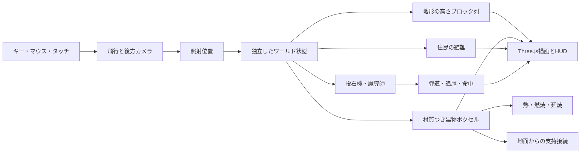

# 飛行・破壊ゲームの技術選定と実装計画

## 目指す体験

人間サイズの神／悪魔が、翼のある身体を後方から見ながら高速で世界を飛ぶ。高度を下げるとドット絵の住民の動きが見え、光を地上になぞると建物が欠け、燃え、地形が削れる。住民は避難し、人類は投石機と魔法で反撃する。遠景の世界地図の感覚から、地上の個々の人間へ自然につながる縮尺を目指す。

最初の判断基準は「移動だけで気持ちよい」「狙った場所が確実に変わる」「地上が反応しているとわかる」の3つ。まず自由なサンドボックスとして成立させ、勝敗や成長システムは操作感を評価してから加える。

## 技術選定

| 候補 | 今回の適性 | 将来の拡張 | 判断 |
| --- | --- | --- | --- |
| Three.js + JavaScript | URLを開いてすぐ試せる。入力・カメラ・照射・小規模ボクセルを素早く調整できる | 地形編集、物理、ツール、配信最適化などを自分で設計する部分が増える | 今回の操作試作に採用 |
| Godot 4系 + GDScript、必要箇所のみネイティブ拡張 | シーン、3D物理、エディタを使って継続制作しやすい | 着陸、搭乗物、衝突、ナビゲーション、コントローラーを追加する候補 | 本制作の第一候補。最終決定前に破壊負荷を計測 |
| Unity | エディタと周辺ツールが選択肢になる | 大規模化にも対応策はあるが今回の範囲では準備が増える | 既存のUnity資産・経験が強い場合に再検討 |
| Unreal Engine | 高品質な3D制作の候補 | 今回のローポリ小規模試作に対し設計・配布の規模が大きくなる | 現時点では採用しない |

これは今回の開発条件に対する判断であり、速度の優劣を実測比較した結果ではない。今回のThree.jsは0.187.0に固定し、依存ファイルを同梱した。試作用コード・操作パラメーター・材質定義は将来の判断材料になるが、Godot移行時の描画・入力・シーン構造は書き直す。

多数の同じ形状をまとめて描画するThree.jsの [InstancedMesh](https://threejs.org/docs/pages/InstancedMesh.html) は建物ブロックと破片に使う。Godotで同様に扱う候補は [MultiMesh](https://docs.godotengine.org/en/stable/classes/class_multimesh.html)。MultiMeshは描画用なので、破壊判定・衝突・支持構造のデータは別途必要になる。[Godotの大量描画に関する公式説明](https://docs.godotengine.org/en/stable/tutorials/performance/using_multimesh.html) も参照。

## 現在の構成

1単位を1mとして扱う。人間スプライトは高さ1.8m、建物は2mボクセル、地面は4m刻み。初期ワールドは400m四方のグリッドで、海に囲まれた主島を配置。建物は中空の壁・屋根・床を実データとして持つ。14軒の民家、城、外壁、6反撃拠点、住民56人を置く。

ボクセルは位置・材質・HP・熱・燃焼時間・所属建物を保持する。8mの空間ハッシュで照射近傍を調べ、全ブロック走査を避ける。描画ではInstancedMeshを使い、消滅した要素の行列を無効化する。地形は露出面だけのメッシュにする。

材質は木材HP28、石材HP100、屋根材HP48を初期値とした。木は低い熱で着火、屋根はより熱を蓄積すると着火、石は不燃。燃える隣接ブロックが熱を与え、燃焼時間またはHPで消滅する。数値はプレイ調整用で、現実の燃焼モデルではない。

地面に触れる建物ボクセルから6近傍の接続を探索し、到達しない部分を崩落させる。影響のあった建物だけを約0.6秒ごとに確認する。瓦礫は粒子として表示し、当たり判定・積み上がりは持たせていない。

住民は照射点・低空のプレイヤーから離れる方向に走る。ブロックへの簡単な回避を行う。投石機は発射時の位置を狙う弾道、魔導師は追尾。足場が消えるか、足元の地形が削れると反撃が止まる。反撃の命中で神威が減り、時間で回復する。尽きた場合は高空へ戻る。

## 今後の順序と完了条件

| 段階 | 実装すること | 完了の判断 |
| --- | --- | --- |
| 0：今回の試作 | 後方飛行、加速・上下移動、光、地面と建物の破壊、材質・延焼・崩落、避難、投石・魔法反撃、再生成、デモ | 起動して一連の遊びを確認できる。計算ロジックと主要画面を検証 |
| 1：操作感を固める | カメラ距離・FOV・加減速・旋回、照準、空中停止、ゲームパッド、反撃の予告と回避、火の見やすさ | 5分飛んで操作が迷いにくい。標的と被弾方向が読める。調整値を固定 |
| 2：本制作のエンジン検証 | Godotに同じ1島・飛行・照射を移植。チャンクボクセル、破壊・衝突更新、固定更新と補間を検証 | 対象PCを決め、数万〜十数万の可視ボクセル・同時火災・住民を計測。フレーム時間とメモリ予算を設定して選定確定 |
| 3：世界と地上戦 | 16または32セルの3Dチャンク、地下空洞、局所的なメッシュ再生成、より賢い避難、射程と遮蔽、町ごとの材質 | 横穴も作れる。町全体が炎上しても予算を守る。住民が安全地帯へ向かう |
| 4：人類の飛行艇 | 巡回と迎撃、弱点部位、飛行艇用ボクセル／部位破壊、離脱と墜落 | 地上の反撃と空中の迎撃で、高度や経路を変える意味が生まれる |
| 5：地上への着陸 | 飛行／接地の状態遷移、地上移動、着陸予測、建物や瓦礫の衝突、近距離カメラ | 破壊後の地形にも着陸し、そのまま再離陸できる |
| 6：継続して遊ぶ形 | 保存と差分復元、複数の国、拠点・目標・成長・難易度、配布形態 | 破壊した世界に戻れる。繰り返しの目的がある |

個人開発での作業量は対象PC、操作感の改修、3D地形方式で大きく変わるため、この段階では日程の確約より各段階の完了条件を優先する。次の作業は段階1のプレイ評価である。

## 拡張時の設計方針

- **地形**：今回の高さ列はクレーター用。3D空間のチャンク配列に替えて空洞へ対応する。露出面のみ生成し、変更チャンクと隣接チャンクだけ更新する。描画・当たり判定・保存差分を分離する。
- **破壊**：全ボクセルを剛体にしない。通常は静的なデータとメッシュ、崩落した連結部分だけ大きな塊で処理。小片は上限つきの粒子にする。
- **燃焼**：燃焼中／加熱中セルだけを更新。固定間隔のイベント処理と、チャンクごとの火災予算を持たせる。GPU描画と火災ロジックの頻度を分ける。
- **住民**：遠距離は低頻度の集団移動、近距離は個別表示。反撃・避難・鎮火などの役割を増やす。再経路探索は地形変更の影響範囲を限定する。
- **飛行艇**：移動する物体ローカル座標にボクセルを保持し、世界座標へ変換して照射判定する。地形と同じ静的グリッドに混ぜない。
- **着陸**：飛行／接地／離陸を明示的な状態にする。建物・地面・大きな瓦礫の衝突形状を更新し、足元の検出とカメラを別に調整する。
- **描画負荷**：まず対象PCを決め、CPU・GPU各フレーム時間、可視面数、ドローコール、火災セル数、破片数を記録する。本試作の自動テスト用ソフトウェア描画から実機のfpsは推定しない。

## 今回の制限

地形は上から削る形式で地下空洞を作れない。レイ判定はサンプリング近似。破壊後の細片には当たり判定がない。樹木と遠景は装飾で、主島の建物・地面だけが破壊対象。住民の経路探索、城全体の力学、火災の酸素・風・水のモデル、飛行艇、着陸は次段階以降。ネットワーク同期や多人数プレイも今回の範囲には含めていない。
